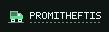
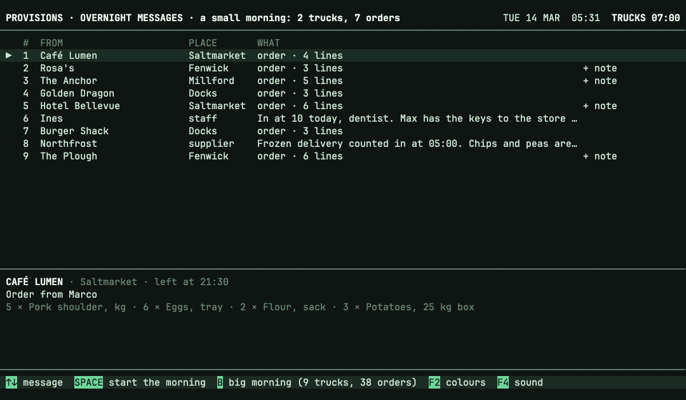
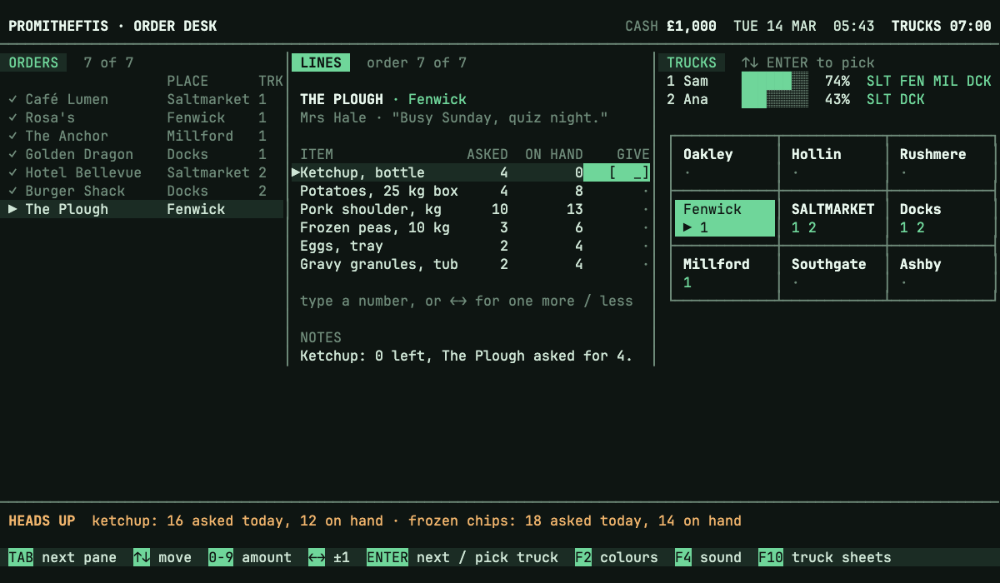
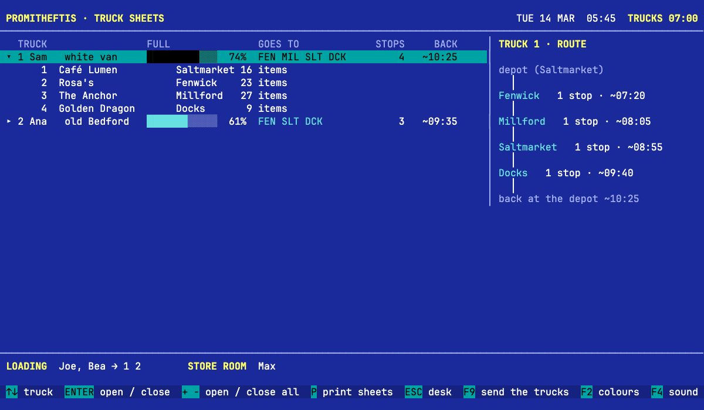
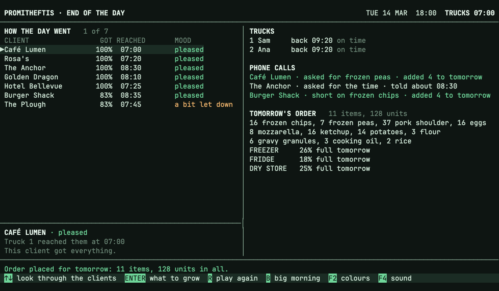
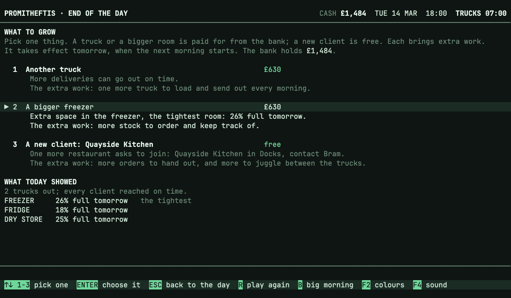
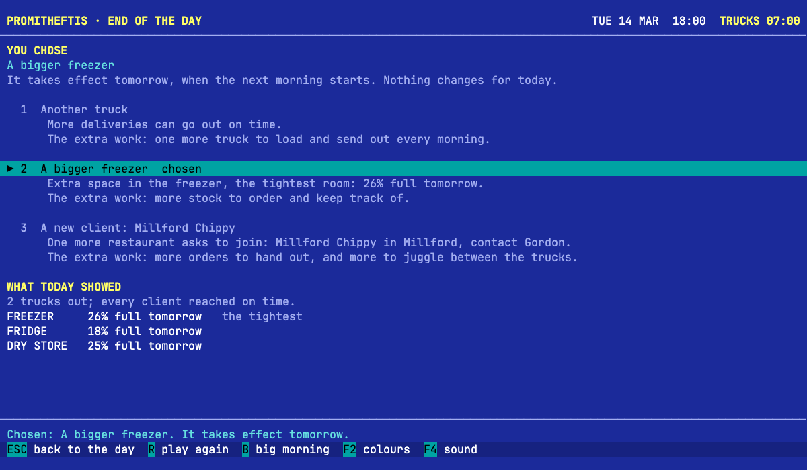
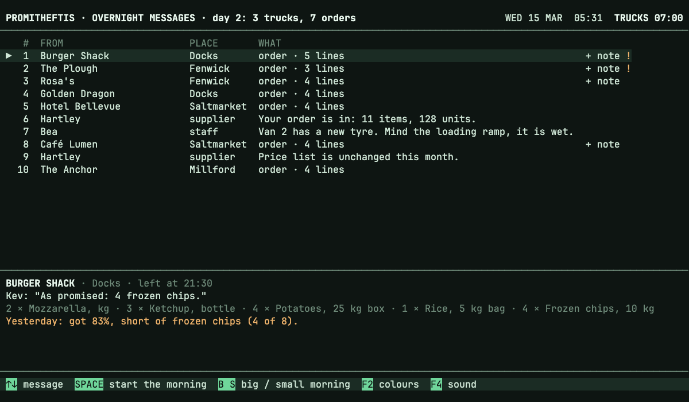
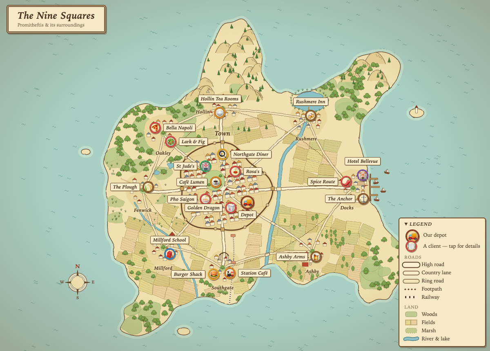

<p align="center">
  
</p>

# Promitheftis

A calm, keyboard-only browser game about running a small restaurant-supply business.

**[Play it in your browser](https://thegallery.github.io/promitheftis/)**, no download needed.

You own a small wholesaler that supplies restaurants. Each morning you hand out the overnight orders against the stock on hand and put each order on a truck before the trucks leave at 07:00. There is no failure screen: if stock runs short, some clients simply get less, and if a truck is sent to places that are far apart, it gets back later.

This is a prototype that plays a run of days. The first day is one fixed morning, in two sizes:

- **the small morning**: 2 trucks and 7 clients (the default);
- **the big morning**: 9 trucks and 38 orders.

After the end of the day, the next morning follows, and the one after that: see [The next morning](#the-next-morning).

It has seven screens, and a short choice at the end of the last one: the overnight messages, the order desk, the truck sheets, the road, a short result screen (when each truck is back, what share of each order was delivered, who got less), the supplier order and the end of the day. On the road the clock runs on from 07:00 and a log fills in as each truck leaves, delivers (with a gentle note when a client got less) and comes back, until every truck is home. Now and then a client rings while the trucks are out (two or three calls in the small morning, a few more in the big one): the log waits, a call box shows who it is and what they say, and you pick a friendly answer with **↑ ↓** and **ENTER**: add it to tomorrow's order, sorry not today, or the time the truck really reaches them. The answers are listed on the result screen, with how many were promised for tomorrow (e.g. "added 4 to tomorrow"); they do not change today's deliveries, but a promise for tomorrow shows up on the next day's order. From the result, **ENTER** goes to the 13:00 supplier order: every item, grouped by where it is kept (freezer, fridge, dry store), with what is on hand after today's deliveries, the usual daily amount and the amount to order for tomorrow. Items a client rang about are drawn in amber, and the note (who rang) shows below the room bars while that row is highlighted. Each room has a bar on the right showing how full it will be tomorrow, with its per cent: █ the stock in the room now, ▓ what is ordered for it and ░ the space left. The bars change as amounts are typed, nudged or filled, so you see before placing the order whether it fits. A room that would be over full gets a bar at full, its per cent and an amber line (e.g. "FREEZER over by 12%"), but the order can still be placed. Placing the order with **F9** ends the day: the 18:00 end-of-day screen wraps it up on one screen. On the left, every client with how much of their order arrived, when the truck reached them, a note when it came after the time they asked for, and their mood; the highlighted client's story shows below it (what was short and why they feel as they do). On the right: each truck and when it got back (with how many clients it reached late), the phone calls with what was answered and promised, and tomorrow's order with how full each store room will be, with an amber warning for a room that is over full. A client is pleased when everything came on time; they are a bit let down, or let down, when less arrived, the truck was late, or they rang about a short delivery and were told nothing more today, and a promise of the rest tomorrow softens that. A client's mood goes with them into the next morning, where it gently changes their order, and a short delivery is remembered for two days (see [The next morning](#the-next-morning)).

From the end of the day, **ENTER** opens one last choice, on the same screen: what to grow. Pick one of three with **↑ ↓** or **1**–**3**, and confirm it with **ENTER**: another truck (more deliveries can go out on time), a bigger room (the freezer, the fridge or the dry store, whichever is the fullest tomorrow, named in the option) or a new client (a restaurant asks to join: one picked at random from a short list, on any of the nine squares and never a client you already have, so it differs from game to game; it is named on the screen). There is no money yet, so each is free; the price is the extra work it brings. Once confirmed, the choice is shown with a note that it takes effect tomorrow. Until you go on, **U** (or **BACKSPACE**, the key bar says "change choice") takes it back and shows the three options again with nothing chosen, so you can pick another or the same one again; a new client on offer stays the same all evening. Once the next morning starts the choice is final. Nothing about today changes. **ENTER** then starts the next morning (the key bar says "next morning"), where the choice takes effect.

### The next morning

The game is a run of days. After the growth choice, **ENTER** goes on to the next morning, at the overnight messages again, with the date in the header a day on (TUE 14 MAR, WED 15 MAR, THU 16 MAR, and so on). What carries over from day to day is a small piece of state: the stock in each store room, the trucks, how big each room is, the clients (and any new one), how each client felt after the last day, and what was promised on the phone.

- **Stock arrives.** The supplier order from the day before is in the store rooms the next morning, on top of what was left. So the stock on the order desk, in the HEADS UP line and on the supplier screen is whatever the player ordered; an item that was not ordered is as low as it was left. A note from the supplier among the overnight messages says what came in.
- **Each new day is made up.** The first day stays the fixed, hand-written morning; from day 2 on, the orders, their notes and the phone calls are different every day, made up with real chance. Every client orders every day, in an order that changes, with their own mix of items and amounts. Orders are kept sensible: no item is asked for in total beyond its usual daily amount, and everything together leaves room on the trucks, so a careful player can mostly fill them. A client who always wants the truck by a time (the hospital, the schools) asks for it every day; others now and then add a note or ask for a time of their own.
- **Moods count.** How a client felt at the end of the last day changes today's order, by one simple rule: a client who was a bit let down asks for about a tenth less and says so in a note, and one who was let down asks for about a quarter less and says so more plainly. A pleased client, and a new one, orders as ever.
- **Short deliveries are remembered.** For each client the run keeps how the last two days went: how much of the order came, what was short, and whether the truck was late. Older days drop off. On the order desk and in the overnight messages, an order from a client who went short in those two days gets a marker in the warning colour: **!** for a client who went short once, **!!** for one who went short two days running (a legend sits under the ORDERS list). When that order is selected, the detail shows in the same colour, in the LINES pane's NOTES on the desk and below the message in the overnight messages: which day (yesterday, 2 days ago), how much came and what was short, e.g. "Yesterday: got 83%, short of frozen chips (4 of 8)." Long lines wrap onto an indented second line. A client who is short again after being short yesterday is a little more let down (one more point in the mood rule, and the end-of-day story says "was short yesterday as well"); a full delivery on time is pleased whatever came before, and the marker is gone once two days have passed. Day 1 has no history, so nothing is marked; **B** and **S** start a fresh run with none, and **R** replays the day with the history it began with.
- **Promises show up.** What the player promised on the phone ("added 4 to tomorrow") is on the client's order the next day: added to the line if they ask for that item, as a new line if not, with a note ("As promised: 4 frozen peas.").
- **The growth choice takes effect.** Another truck is one more truck that morning (on the desk, the sheets, the road and the end of the day). A bigger room is more space in that room, which the room bars on the supplier screen show (the freezer 300 → 400, the fridge 520 → 670, the dry store 800 → 1000). A new client joins and sends orders from that morning, and the usual daily amounts on the supplier screen grow by that client's share.

**R** plays the current day again, from its overnight messages, with the same orders; on day 1 that is the fixed morning. **B** and **S** load the fixed big or small morning and start the run over from day 1. The first day of every run is the same; the later days are made up from chance, so they differ from run to run.

### Saving

The run is saved in your browser (its local storage), by itself: there is no save key. It is saved when a day begins, that is, when the next morning starts after the growth choice, and when a new run starts. Closing the page loses only the day in play, and carrying on later puts you at the start of the day that was saved, at its overnight messages, exactly as **R** would play it again: the same orders, notes and calls. The growth choice is part of that: once the next morning has started, it is in the saved run. The colours (**F2**) and the sound (**F4**) are saved too.

- **To carry on**, open the page again. When a run is saved, the first screen offers three choices with **↑ ↓** and **ENTER**: **Continue** (it says which day and date), or a new run from the small or the big morning. **C** continues, **S** and **B** start a new run.
- **To start over**, choose a new run on that first screen, or press **B** or **S** at the overnight messages, the result or the end of the day (and the growth choice). A new run replaces the saved one, so from day 2 on a tap is not enough: the bottom of the screen asks "Start a new run? It replaces your saved day N." and shows a button, **[ HOLD B TO START A NEW RUN ]** (or **S**, whichever key you pressed), with a bar beside it. Keep the key held down for about a second and a half and the bar fills from left to right (░ to █, in the accent colour); when it is full the new run starts, with a soft key sound, and replaces the save. Let go early and the bar empties and nothing happens (hold again to try once more). **ESC**, or any other key, cancels the question and the save is untouched. On day 1 there is nothing to lose, so one press starts the new run, and on the first screen the choice already says it replaces the saved run. **R** only plays the day again and leaves the save alone.
- **If it cannot be read** (a save from an older version of the game, or one that has been damaged), it is ignored: a new run starts on the first day and a short note says so.
- **If the browser will not keep anything** (a private window, blocked site data, no room left), the game plays as ever, just without saving.

Only this browser on this computer has the save: there is no account, no cloud, one slot, and no way to move a run to another browser.

Left out on purpose: new clients ringing, answers that change anything beyond a promise for tomorrow, money.

## What it looks like



*The morning starts with the overnight messages: orders from clients, plus a note from a staff member and one from a supplier.*



*The order desk: for each line you decide how much to give, and the stock on hand (here, no ketchup left) shows when someone will get less.*



*The truck sheets, here in office blue (F2): each truck's orders, its route and when it is back at the depot.*



*The end of the day at 18:00: each client's mood, when the trucks got back, the phone calls and how full each store room will be tomorrow.*



*Then one thing to grow: another truck, a bigger room (here the freezer, the tightest) or a new client. Nothing is paid for; each brings extra work.*



*Once chosen, it is shown with a note that it takes effect tomorrow; ENTER starts the next morning.*



*The next morning, with the stock the player ordered, a promise from the phone on the client's order, the date a day on, and a "!" with a note for each client that went short the day before.*

## Where it happens



*The Nine Squares: our depot sits in Saltmarket, and every client lives somewhere on this little island.*

Promitheftis (Greek for "supplier") is set on a small imaginary island: a town called Saltmarket with eight neighbouring places around it. There are woods and a lake to the north, fields in the south, a harbour on the east side and a railway line through Southgate. Some of the places and clients you will meet are on this map.

## Run it

You need Node.js 24 (see `.nvmrc`).

Dependencies are installed through [Socket Firewall](https://socket.dev/blog/introducing-socket-firewall) (`sfw`), here and in CI, so a known-malicious package is blocked before it is installed. Install it once with `npm install --global sfw`, then:

```sh
sfw npm ci
npm run dev
```

Open the URL Vite prints (http://localhost:5173/). The screen is 120 columns wide and fills the page. Use the keyboard only: there is nothing to click.

Other commands:

```sh
npm test            # unit tests for the rules and the screens
npm run typecheck   # TypeScript
npm run build       # production build in dist/
```

## Keys

Keys that work everywhere: **F2** switches between soft green and office blue, **F4** turns the sounds on and off. The bar along the bottom of every screen lists the keys for that screen.

| Screen | Keys |
| --- | --- |
| Opening screen (when a run is saved) | **↑ ↓** pick **Continue** or a new run from the small or the big morning · **ENTER** go · **C** continue · **S** small morning · **B** big morning |
| Overnight messages | **↑ ↓** read through the messages · **SPACE** start the morning · **B** load the big morning · **S** load the small morning (both start the run over from day 1 and replace the saved run; from day 2 on, hold the key down until the bar beside the button fills; a tap only asks) |
| Order desk | **TAB** next pane (**Shift+TAB** back) · **↑ ↓** move within a pane · type a number or **← →** (one less / one more) for the amount on a line · **ENTER** accept the line and go to the next · **ENTER** on the highlighted truck in the TRUCKS pane puts the order on it · **F10** truck sheets |
| Truck sheets | **↑ ↓** pick a truck · **ENTER** open or close it · **+** / **−** open or close all · **P** print the sheets (with the printer sound) · **ESC** back to the desk · **F9** send the trucks |
| On the road | **SPACE** or **ENTER** skip ahead (it stops at each call) · when the phone rings, **↑ ↓** pick an answer and **ENTER** gives it · once every truck is back and the calls are answered, **ENTER** goes to the result |
| Result | **↑ ↓** look through the orders · **ENTER** supplier order · **R** play this day again · **B** / **S** load a morning |
| Supplier order | **↑ ↓** pick an item · type a number or **← →** (one less / one more) · **ENTER** confirm the row and go to the next · **U** fill the row up to the usual amount · **A** fill every row (both leave a row that already has an amount alone) · the room bars update as you go · **F9** place the order and go to the end of the day · **ESC** back to the result |
| End of the day | **↑ ↓** look through the clients (**PgUp** / **PgDn** ten at a time) · **ENTER** choose what to grow · **R** play this day again · **B** / **S** load a morning |
| What to grow | **↑ ↓** or **1**–**3** pick one of the three · **ENTER** choose it, then **ENTER** again for the next morning (the choice is final from then on) · **U** or **BACKSPACE** take the choice back · **ESC** back to the day · **R** play this day again · **B** / **S** load a morning |

### How the desk plays

- The **ORDERS** pane lists the orders with each one's place and truck. **LINES** shows the current order: each item, what was asked, what is on hand, and what you give. **TRUCKS** shows each truck's fullness and the places it already goes to, with the nine squares under it.
- On a line, **ENTER** gives as much as was asked, or as much as there is. Type a number or use **← →** to give a different amount. A truck that is full takes no more.
- After the last line, choose a truck: **↑ ↓** to highlight it in the TRUCKS pane, then **ENTER**. The order is finished and the desk moves to the next one.
- The **HEADS UP** line lists items that today's orders ask for more of than there is on hand, so you can hold some back for later clients.
- The clock moves a minute for each truck you pick and each order you finish, not in real time. The trucks leave at 07:00.

### The map

Nine squares, with Saltmarket in the middle:

```
Oakley    Hollin     Rushmere
Fenwick   SALTMARKET Docks
Millford  Southgate  Ashby
```

Orders for the same place should go on the same truck. Places next to each other (squares that touch, corners included) can share a truck. A truck sent to places far apart gets back late; that is the only penalty. Each square shows the numbers of the trucks going there, and the current order's square is lit.

## How it is built

Plain TypeScript with Vite and no UI framework; Vitest for tests.

- `src/game/` holds the rules and has no screen code: the map (`places.ts`), the two mornings (`morning.ts`), the order desk with stock, truck fullness and the clock (`desk.ts`), return times (`routes.ts`), the log of the drive (`road.ts`), the phone calls (`calls.ts`), shortages (`headsup.ts`), the result (`results.ts`), the supplier order (`supply.ts`), the end of the day (`day.ts`) with the client moods (`moods.ts`), the last two days of each client (`history.ts`) and the growth choices (`growth.ts`), the store rooms with their sizes and the space each item takes (`rooms.ts`), what carries over from day to day and how the growth choice is put to work (`run.ts`), and the made-up days after the first (`generate.ts`, with its random source in `random.ts`), and the saved run and settings, with their version and checks on what is read back (`save.ts`).
- `src/ui/` holds the screens. Each screen builds lines of text of exactly 120 columns (`grid.ts`, `screens/`); `app.ts` holds the state and what each key does (the random source for the new days is passed in, so tests can make it fixed); `view.ts` and `main.ts` put the text on the page; `audio.ts` plays the sounds, with the Soft keys set in `softkeys.ts`; `store.ts` is the one place that touches the browser's local storage and never throws.
- `tests/` has the unit tests, including a full play-through of both mornings, and of the days after them, that checks that every screen is exactly 120 columns by 30 rows.

## Sounds and fonts

The sounds are made in code with the Web Audio API, so there are no sound files: gentle "soft key" keyboard clicks, a little deeper for ENTER, with a low double knock when an order is finished and a soft double thud for a warning, and the dot-matrix printer on the truck sheets. On the road each step of the clock makes a soft click, and the last one, when every truck is back, is the finishing knock; an incoming call has a soft two-note ring. Each key press makes one sound at most: a key that only shows a message at the bottom plays the warning, and a key that changes nothing at all is silent. The font is [JetBrains Mono](https://www.jetbrains.com/lp/mono/), used under the SIL Open Font License 1.1 (`src/assets/fonts/OFL.txt`).

## License

MIT, see [LICENSE](LICENSE).
