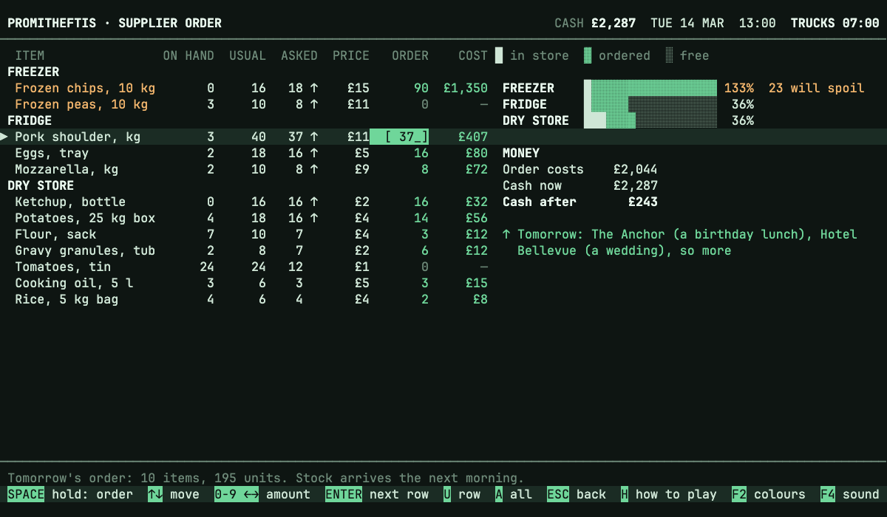
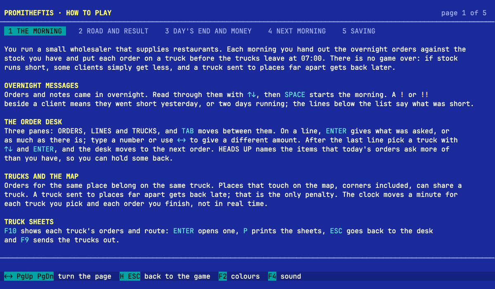

<p align="center">
  
</p>

# Promitheftis

A calm, keyboard-only browser game about running a small restaurant-supply business.

**[Play it in your browser](https://thegallery.github.io/promitheftis/)**, no download needed.

Each morning you hand out the overnight orders against the stock on hand and put them on trucks before they leave at 07:00. There is no failure screen: if stock runs short, some clients simply get less, a truck sent to places far apart gets back later and costs more, and a client who asked to be reached before a time pays half for an order that arrives after it. Then you order stock for tomorrow, which means reading the notes on the orders and the bars of the store rooms, since what a room cannot hold spoils. You look back at the day, which shows how full the trucks really were, and choose one thing to grow: a truck (each costs more than the last), a bigger room, or a new client who may be big or small, near or far, always early or heavy on one store room. Now and then the supplier delivers less than you ordered, and the overnight notes say which item, so the scarce stock has to be shared out, and now and then a truck is at the garage for the day, so a spare truck is worth having. Then the next morning begins. The game explains itself: press **H** on any screen for how to play.







## Run it

You need Node.js 24 (see `.nvmrc`). Dependencies are installed through [Socket Firewall](https://socket.dev/blog/introducing-socket-firewall) (`sfw`), here and in CI: install it once with `npm install --global sfw`, then:

```sh
sfw npm ci
npm run dev         # open the URL Vite prints
npm test            # unit tests for the rules and the screens
npm run typecheck   # TypeScript
npm run build       # production build in dist/
```

## How it is built

Plain TypeScript with Vite and no UI framework; Vitest for tests.

- `src/game/` holds the rules and has no screen code: the map, the mornings, the order desk, the road, the phone calls, the supplier order, the end of the day, money, growth, and the run of days with its saved state.
- `src/ui/` holds the screens. Each one builds lines of text of exactly 120 columns; `app.ts` holds the state and what each key does, `view.ts` and `main.ts` put the text on the page, and `store.ts` is the one place that touches the browser's local storage.
- `tests/` has the unit tests, including a full play-through that checks every screen is 120 columns by 30 rows.

## Sounds and fonts

The sounds are made in code with the Web Audio API, so there are no sound files: gentle "soft key" keyboard clicks, a dot-matrix printer on the truck sheets and a soft ring for the phone. The font is [JetBrains Mono](https://www.jetbrains.com/lp/mono/), used under the SIL Open Font License 1.1 (`src/assets/fonts/OFL.txt`).

## License

MIT, see [LICENSE](LICENSE).
